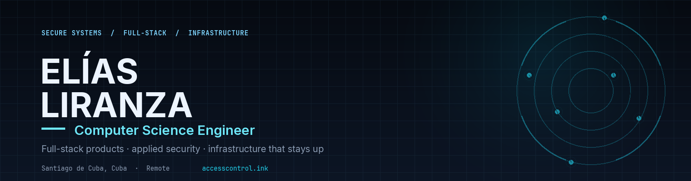

<picture>
  <source media="(prefers-color-scheme: dark)" srcset="./assets/banner-dark.png">
  <source media="(prefers-color-scheme: light)" srcset="./assets/banner-light.png">
  
</picture>

<h1 align="center">Elías Eduardo Liranza Pérez</h1>

  <b>Computer Science Engineer · Full-Stack &amp; Cybersecurity · Infrastructure &amp; Cloud</b> 
  Founder of <a href="https://accesscontrol.ink">Credential Digital</a> · Building secure, offline-first systems

  
  
  

I build full-stack products with a security-first mindset: multi-tenant SaaS, offline-first access control, encrypted credentials, and infrastructure that stays up when the network doesn't. I currently combine network administration at the Provincial Directorate of Education with remote full-stack work for Church Tech Solution.

## What I do

| Full-stack engineering | Cybersecurity &amp; AppSec | Infrastructure &amp; cloud |
| :--- | :--- | :--- |
| Django, NestJS, Angular, React Native, PostgreSQL | ECDSA, AES-256, OAuth2/JWT, OWASP Top 10 | Proxmox VE, Docker, Linux, Nginx, Cloudflare |
| Multi-tenant SaaS, payments, auth, observability | Security audits, threat modeling, offline validation | 8-node cluster, 14 LXC, NAS/NFS, backups |
| Shipping products end-to-end | Turning findings into verifiable fixes | Keeping systems available and recoverable |

## Selected work

| Project | What it is | Impact &amp; stack |
| :--- | :--- | :--- |
| **[Credential Digital](https://accesscontrol.ink)** · Founder | Multi-tenant physical access control SaaS with QR/NFC credentials, ECDSA P-521 signatures and offline validation. | Django 6 · PostgreSQL 16 · Redis · React Native · Docker · Stripe/Adyen/Mollie/Mercado Pago. 2,856 tests; 10k concurrent-user benchmark. |
| **FollowApp** · Church Tech Solution | Customer tracking and loyalty platform for web and mobile. | NestJS · Angular · Flutter · PostGIS · Firebase. Audit: 160 findings, 43 mitigations, 59/60 checks PASS. |
| **[Shadow-Tunel](https://github.com/eliaselp/Shadow-Tunel)** · Open source | Self-hosted WireGuard VPN with a one-command installer. | Shell · WireGuard · Linux · Cloudflare. |
| **[CyBlack](https://github.com/eliaselp/CyBlack)** · Open source | Centralized malicious-URL classification system. | Python · ML · 10,000+ URLs · 94% validation accuracy. |
| **[Private Cloud Server](https://github.com/eliaselp/Private-Cloud-Server)** · Open source | Encrypted file storage and folder sharing with RBAC. | Flask · AES-256 · 50 concurrent users · 20 GB transfers. |

Some production work is private. I can walk through architecture, trade-offs and results on request.

## Stack

  

  <b>Security:</b> ECDSA · AES-256-GCM · OAuth2/JWT · OWASP Top 10 · ISO 27001 · NIST 800-53 
  <b>Infrastructure:</b> Proxmox VE · LXC/VM · WireGuard · Cloudflare · NAS/NFS · CI/CD

## Currently

- Building **Credential Digital** — secure access control for organizations that cannot depend on connectivity.
- Open to **remote full-stack, security or infrastructure** roles.
- Studying **CS50 Cybersecurity** and **CS50 Computer Science** (HarvardX).

## Activity

<picture>
  <source media="(prefers-color-scheme: dark)" srcset="https://github-readme-activity-graph.vercel.app/graph?username=eliaselp&theme=tokyo-night&hide_border=true&area=true&custom_title=Contribution%20activity">
  <source media="(prefers-color-scheme: light)" srcset="https://github-readme-activity-graph.vercel.app/graph?username=eliaselp&theme=github-compact&hide_border=true&area=true&custom_title=Contribution%20activity">
  
</picture>

<b>Contribution snake · last 3 years</b>

<picture>
  <source media="(prefers-color-scheme: dark)" srcset="https://raw.githubusercontent.com/eliaselp/eliaselp/output/github-snake-dark.svg">
  <source media="(prefers-color-scheme: light)" srcset="https://raw.githubusercontent.com/eliaselp/eliaselp/output/github-snake.svg">
  
</picture>

---

  <i>I care about systems that are secure by design, observable in production, and documented enough that the next engineer can own them.</i>  
  <a href="mailto:liranzaelias@gmail.com">liranzaelias@gmail.com</a> ·
  <a href="https://www.linkedin.com/in/elias-eduardo-liranza-p%C3%A9rez/">LinkedIn</a> ·
  <a href="https://accesscontrol.ink">accesscontrol.ink</a>

